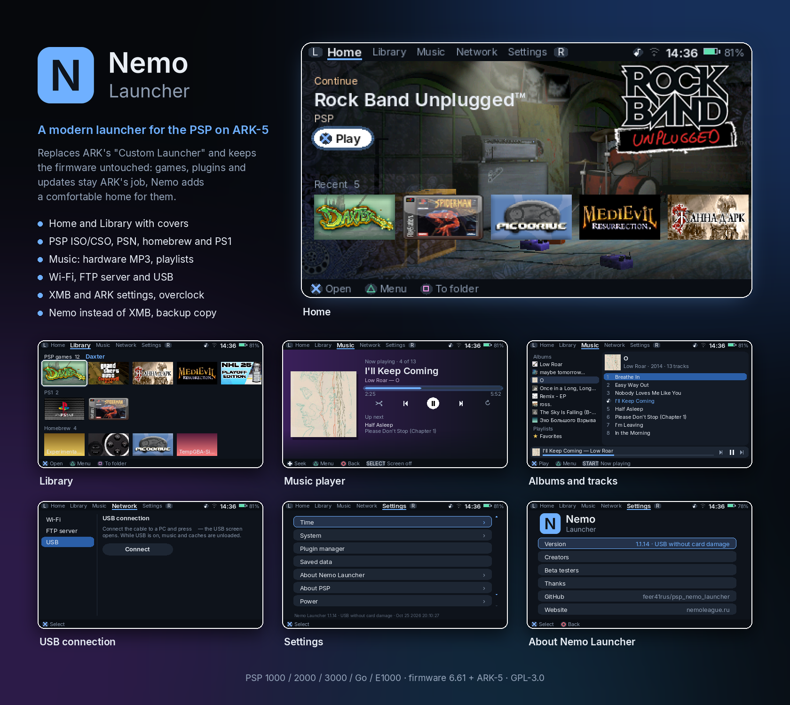

<p align="center"></p>

# Nemo Launcher

**English** · [Русский](README.ru.md)

<p align="center"></p>

A modern launcher for the PSP running the **ARK-5** custom firmware. It replaces ARK's "Custom Launcher" (`VBOOT.PBP`) and keeps ARK itself untouched: games, plugins and updates stay ARK's job, Nemo adds a comfortable home for them.

Made with ❤ by Schastlivyy Vladislav together with **NCL — Nemo console league**.

## Features

- **Home and Library**: covers and backgrounds from the games, "Continue" banner, recently played, your own folders, on-screen keyboard (Russian/English).
- **Games**: PSP ISO/CSO, PSN and homebrew EBOOTs, PS1 EBOOTs with multi-disc grouping. Game card with **saved data** management, a **per-game CPU clock** and **deleting a game** (with confirmations).
- **Music player**: MP3 through the PSP's **hardware decoder** (instant track switching, low CPU), FLAC/OGG/WAV in software; queue, shuffle/repeat, favourites, playlists, sleep timer, listening mode with the screen off, Albums / Artists / Folders / All tracks views (□ button), `.m3u` playlist import and export, a 5-band equalizer with presets, ♪ / Select+L/R controls (PSP Go / E1000 have no ♪ key).
- **Splash screens and sounds**: at power-on — "Welcome! Your PSP. The way it should be." with a chime (any button skips); for sold consoles — a one-time "Thank you for buying your console from NCL" ("NCL screen › On next start"); quiet XMB-like interface sounds, silent while music plays. All set in "Settings › System › Nemo".
- **Network**: Wi‑Fi scanning and connecting (WPA2 via ARK), **FTP server**, **USB** mass storage; the library rescans itself afterwards.
- **Settings** shared with the XMB: date/time (fixes a 1970 clock), formats, time zone, nickname, system language, brightness, backlight auto-off, auto sleep, confirm button.
- **ARK settings** in Nemo: USB charging, extra memory, memory stick speedup, Inferno cache, Sony logo skip, LEDs/UMD/analog stick, UMD region, **overclock** (games / XMB / Nemo, up to 443 MHz — experimental, at your own risk), **plugin manager**.
- **Battery** (Settings › About PSP): charge, voltage, temperature, capacity and wear, cycles and serial number; a real-capacity test with its own load and result graphs (PSP Go / E1000 readings may be inaccurate).
- **Power window**: hold HOME 1 s — sleep, restart, turn off (and exit to XMB if enabled).
- **Nemo instead of XMB**: the PSP starts straight into Nemo; two failed starts in a row switch it off automatically. A backup copy (`PSP/APP/CUSTOM`, XMB item "Nemo Launcher (backup)") restores Nemo if an ARK update replaces it.
- Russian and English interface, following the system language.

## Controls

| Buttons | Action |
|---|---|
| ✕ / ○ | Select / back (which one selects follows XMB, Settings › System › Confirm button) |
| D-pad, analog stick | Move; ← → on a shelf scroll the games |
| L / R | Previous / next tab |
| △ | Action menu (game, folder, track); in a password field — show / hide the characters |
| □ | Quick action: on a shelf — add to folder, in the queue — remove the track, on the keyboard — delete a character |
| □ in Music | Library view: Albums → Artists → Folders → All tracks; on the equalizer screen — reset |
| START | On the keyboard — done; in Music — Now Playing |
| HOME (press) | Go Home / close a window |
| HOME (hold 1 s) | Power window: sleep, restart, turn off, exit to XMB |
| ♪ | Music: pause / resume |
| ♪+L / ♪+R | Previous / next track |
| SELECT+L / SELECT+R | The same, for PSP Go and E1000 (no ♪ button); with the screen off it stays off |
| SELECT on Now Playing | Listening mode (screen off); a short SELECT turns the screen back on |
| SELECT+START | Screenshot to `PSP/NEMO/screenshots/` |
| SELECT+△ | Debug: the bottom line and the RAM / CPU / FPS box (Settings › System › Debug) |
| Volume + / − | Volume (Nemo's own indicator) |
| Headphone remote | Pause, next / previous track |
| L on the on-screen keyboard | Hold for capitals |

## Requirements

- PSP (1000/2000/3000/Go/E1000) or PS Vita with **firmware 6.61** (or 6.60 — see below how to update) and **[ARK-5](https://github.com/PSP-Arkfive/ARK-5)**. Nemo shows a message and returns to the XMB on anything else.

### Prepare the PSP: firmware 6.61

ARK-5 (and so Nemo) needs the official system software **6.61** (6.60 also works). Check it in the XMB: *Settings › System Settings › System Information*. Official update files from Sony's server (the same links ARK-5's DC10 uses):

- PSP 1000/2000/3000/E1000 (Street): [6.61 update](http://du01.psp.update.playstation.org/update/psp/image/us/2014_1212_6be8878f475ac5b1a499b95ab2f7d301/EBOOT.PBP)
- PSP Go: [6.61 update for Go](http://du01.psp.update.playstation.org/update/psp/image2/us/2014_1212_fd0f7d0798b4f6e6d32ef95836740527/EBOOT.PBP)

**On official firmware below 6.61:** copy the update to `PSP/GAME/UPDATE/EBOOT.PBP` on the memory stick, run it from the XMB (*Game › Memory Stick*) with a charged battery and the charger plugged in, then install ARK-5.

**Coming from PROMOD / PRO-C on 6.60–6.61:** step-by-step guide — [moving from PROMOD to ARK-5](guides/promod-to-ark5.md).

**Coming from another custom firmware (ME, LME, …):** don't update over it. Use the [DC10](https://github.com/PSP-Arkfive/Despertar-Del-Cementerio) way from the `full` archive: rename the update to **`661.PBP`** (PSP Go: **`661GO.PBP`**) and copy it to the root of the memory stick → run `Custom IPL` and install the new cIPL → turn the PSP off and on holding **L** → in DC10 choose *Install 6.61 ARK*. Battery fully charged, never turn the PSP off while it installs.

## Installation

Two archives are attached to each [release](https://github.com/feer41rus/psp_nemo_launcher/releases):

**`…_lite_no_ark-5.zip`** — ARK-5 is already installed:
1. On the memory stick, open `PSP/SAVEDATA/ARK_01234/`. If there is a `VBOOT.PBP`, rename it to **`VBOOT_ARK.PBP`** (ARK's own launcher; Nemo can still open it from Settings › Exit).
2. Copy `VBOOT.PBP`, `lang_ru.json` and `lang_en.json` from the archive into that folder.
3. Restart the XMB. Start Nemo from the XMB item **"Nemo Launcher"** (ARK's launcher item).

**`…_full_with_ark-5.zip`** — ARK-5 (PSP files of the official [FasterARK](https://github.com/PSP-Arkfive/FasterARK) "full" package) with Nemo already in place:
1. Copy the `PSP` folder to the root of the memory stick (merge).
2. Install/run ARK-5 as described in the [ARK-5 instructions](https://github.com/PSP-Arkfive/ARK-5).

Updating Nemo: replace `VBOOT.PBP` (and the two `lang_*.json`).

### If something goes wrong

- "Nemo instead of XMB" switches itself off after two failed starts.
- Otherwise, on a PC (card reader or USB from the XMB): delete `PSP/SAVEDATA/ARK_01234/VBOOT.PBP` and rename `VBOOT_ARK.PBP` back to `VBOOT.PBP` — this is ARK exactly as before.

## Building

The PSP toolchain runs in Docker:

```sh
make psp                   # dist/VBOOT.PBP + dist/lang_*.json (Docker image pspdev/pspdev)
make release CHANNEL=PROD  # dist/release/*.zip (needs zip/unzip and FasterARK_psp_full.zip, see Makefile)
```

## Release channels

`PROD` — tested releases; `PRE-ALPHA` — feature-complete builds under test; `DEV` — work in progress. Version numbers are shown at the bottom of Settings.

## Thanks

<!-- credits:start -->
Thanks to the projects Nemo Launcher is built on or learned from.

### Firmware and PSP launchers
- **ARK-5** — https://github.com/PSP-Arkfive/ARK-5 (GPL-3.0) — the custom firmware; `sctrl*` API, launching games, launcher mode, the NID table (`SystemControl/src/nid_660_data.c`), its plugin manager (`XMBControl/src/plugins.c`) as the model for ours. ARK's Russian XMB translation (`lang_ru.json` from `LANG.ARK`) is the base of our `lang_ru.json` with the "Nemo Launcher" name.
- **FasterARK** — https://github.com/PSP-Arkfive/FasterARK (no license stated) — ARK installer/updater; how the launcher and themes are installed; its "full" package is the base of the `full_with_ark-5` archive.
- **Launcher-Menus (arkMenu, xMenu, vshMenu)** — https://github.com/PSP-Arkfive/Launcher-Menus (GPL-3.0) — ARK's launcher; how to start ISO/PBP/PS1/homebrew, reading HOME/♪ through kubridge, the impose volume workaround (reference, no code copied).

### Network
- **WPA2 for PSP** by @Moment — built into ARK-5: `Compat/PSP/src/wpa2.c` (patch of `sceNetApctl_Library`, setting `always, wpa2, on`). It lets the PSP join WPA2-PSK (AES) routers.
- **How-to-connect-your-psp-to-the-internet** — https://github.com/stefanos-git/How-to-connect-your-psp-to-the-internet (no author or license stated) — guide and the `wpa2psp.prx` plugin; not included in Nemo — ARK-5 already has it built in.
- **libpspftp** — https://github.com/pspdev/libpspftp (MIT) — the PSP FTP server (`ftpd`) behind FTP in the Network tab.
- **PPSSPP** — https://github.com/hrydgard/ppsspp (GPL-2.0 or later) — NIDs of the network scan functions `sceNetApctlScanUser` / `GetBSSDescIDListUser` / `GetBSSDescEntryUser`, the Media Engine documentation (reference, no code copied).
- **Launcher-Menus / arkMenu** (GPL-3.0) — `network.cpp`, `net_mgr.cpp`, `usb.cpp`: network start-up order, starting FTP, USB mode (reference, no code copied).

### Overclocking
- **psp-undocumented-sorcery / experimental-overclock** by mcidclan — https://github.com/mcidclan/psp-undocumented-sorcery — clocks above 333 MHz (up to 443), built into ARK-5 (`Compat/PSP/src/overclock.c`); Nemo turns it on through ARK's `cpuclock:N` settings.

### Music
- **MP3PlayerPlugin** by plum_429 — https://github.com/PSP-Archive/MP3PlayerPlugin (GPL-3.0) — background music in the XMB and games; the base of the planned in-game music plugin (1.2).
- **vshbgm** by Koutsie — https://github.com/PSP-Archive/vshbgm (GPL-2.0) — background music in the VSH with `sceAudiocodec`.
- **BatterySteve** by koutsie — https://github.com/koutsie/BatterySteve (no licence stated) — the idea of testing the real battery capacity by draining it under load (no code copied).
- **pspmp3 / sceMp3** (PSPSDK, BSD) — https://github.com/pspdev/pspsdk — the hardware MP3 decoder (Media Engine).
- **dr_flac** by David Reid — https://github.com/mackron/dr_libs (public domain or MIT-0) — FLAC decoder (v0.12.42, copied from SDL_mixer 2.8.1); SDL_mixer in pspdev is built without FLAC.
- **The Mp3 Info Tag (LAME tag)** by Gabriel Bouvigne — http://gabriel.mp3-tech.org/mp3infotag.html — the Xing/Info and LAME tag format: frame count, seek TOC, encoder delay and padding for gapless playback.
- **VBRI header** (Fraunhofer) — reference for parsing (no code copied).

### Tools and libraries
- **pspdev / PSPSDK** — https://github.com/pspdev/pspdev (BSD) and the `pspdev/pspdev` Docker image — the PSP toolchain.
- **psp-cfw-sdk** — https://github.com/pspdev/psp-cfw-sdk — CFW headers and libraries (`systemctrl`, `kubridge`, `arkctrl`); PRO CFW / ARK code under GPL-3.0 or later — which is why Nemo Launcher is released under GPL-3.0-or-later.
- **SDL2, SDL2_mixer, SDL2_ttf, SDL2_image** — https://github.com/libsdl-org (zlib) — graphics, sound, fonts, images.
- **SDL2_gfx** — https://www.ferzkopp.net/wordpress/2016/01/02/sdl_gfx-sdl2_gfx/ (zlib) — primitives (rounded rectangles, circles).
- **cJSON** — https://github.com/DaveGamble/cJSON (MIT) — JSON for Nemo's data.
- **Inter** — https://github.com/rsms/inter (SIL OFL 1.1) — the interface font (cut down to Latin and Cyrillic).
<!-- credits:end -->

**Beta testers:** Schastlivyy Vladislav (feer41rus), Alexander NCL.

Artificial intelligence (Claude) was used to create Nemo Launcher.

## License

Nemo Launcher is free software under the **GNU General Public License v3.0 or later** — see [LICENSE](LICENSE). It is built with GPL-3.0 code from the PRO CFW / ARK SDK (systemctrl, kubridge, ARK control libraries), so GPL-3.0 applies to the whole program. Bundled third-party code keeps its own license: cJSON (MIT, `third_party/cjson`), libpspftp (MIT, `third_party/libpspftp`), Inter font (SIL OFL 1.1, `assets/fonts/OFL.txt`).

The NCL logo belongs to NCL — Nemo console league. PSP and PlayStation are trademarks of Sony Interactive Entertainment; this project is not affiliated with Sony.
