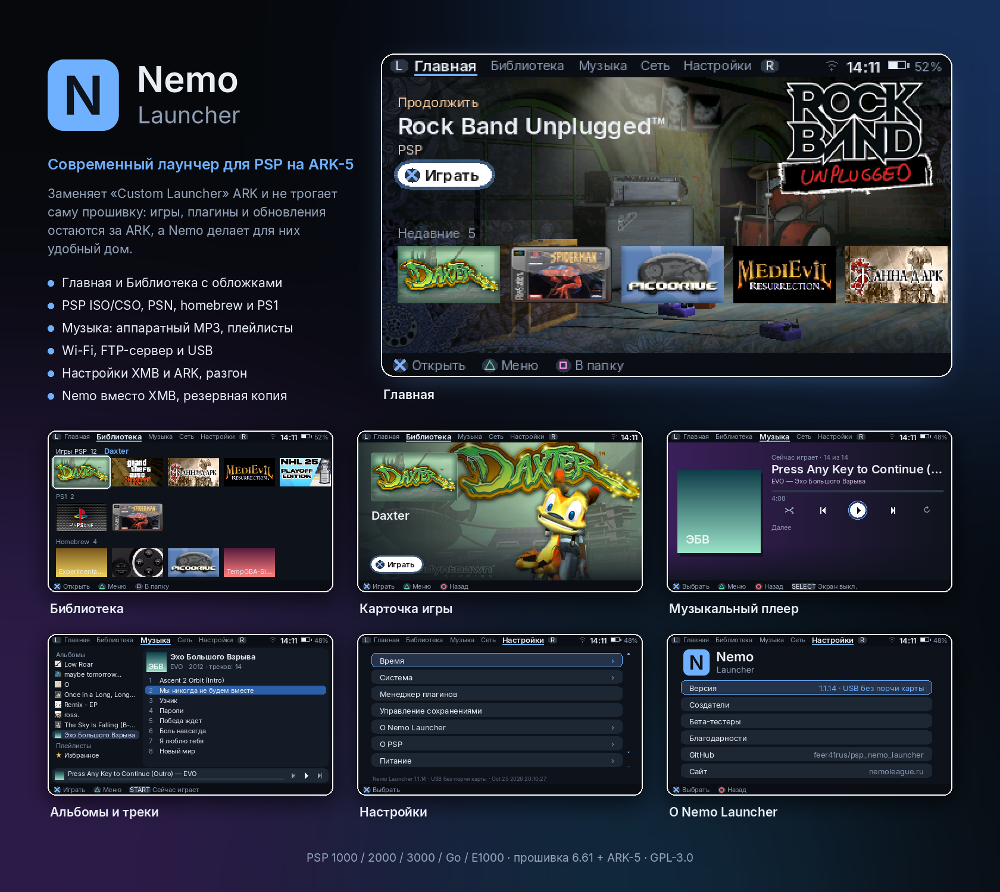

<p align="center"></p>

# Nemo Launcher

[English](README.md) · **Русский**

<p align="center"></p>

Современный лаунчер для PSP на кастомной прошивке **ARK-5**. Он заменяет «Custom Launcher» ARK (`VBOOT.PBP`), а сам ARK не трогает: игры, плагины и обновления остаются делом ARK, а Nemo делает для них удобный дом.

Сделано с ❤ Schastlivyy Vladislav вместе с **NCL — Nemo console league**.

## Возможности

- **Главная и Библиотека**: обложки и фоны из игр, «Продолжить», недавние, свои папки, экранная клавиатура (русская/английская).
- **Игры**: PSP ISO/CSO, PSN и homebrew EBOOT, PS1 EBOOT с объединением многодисковых игр. В карточке игры — **сохранения**, **индивидуальный разгон** и **удаление игры** (с переспросами).
- **Музыкальный плеер**: MP3 через **аппаратный декодер** PSP (мгновенное переключение, малая нагрузка), FLAC/OGG/WAV программно; очередь, перемешивание/повтор, избранное, плейлисты, таймер сна, режим прослушивания с выключенным экраном, ♪ / Select+L/R (у PSP Go и E1000 нет кнопки ♪).
- **Сеть**: поиск и подключение к Wi‑Fi (WPA2 через ARK), **FTP-сервер**, **USB**-подключение; после них библиотека пересканируется сама.
- **Настройки**, общие с XMB: дата и время (исправляет сбитые на 1970), форматы, часовой пояс, псевдоним, язык системы, яркость, автовыключение подсветки, автосон, кнопка подтверждения.
- **Настройки ARK** прямо в Nemo: зарядка по USB, память, ускорение карты, кэш Inferno, пропуск заставки Sony, светодиоды/UMD/мини-джойстик, регион UMD, **разгон** (игры / XMB / Nemo, до 443 МГц — эксперимент, на свой страх и риск), **менеджер плагинов**.
- **Окно питания**: удержание HOME 1,5 с — сон, перезагрузка, выключение (и выход в XMB, если включён).
- **Nemo вместо XMB**: PSP включается сразу в Nemo; после двух неудачных запусков подряд режим выключается сам. Запасная копия (`PSP/APP/CUSTOM`, пункт XMB «Nemo Launcher (резерв)») восстанавливает Nemo, если обновление ARK его заменит.
- Русский и английский интерфейс, по языку системы.

## Требования

- PSP (1000/2000/3000/Go/E1000) или PS Vita с **прошивкой 6.61** (или 6.60 — ниже, как обновиться) и **[ARK-5](https://github.com/PSP-Arkfive/ARK-5)**. На другом Nemo покажет сообщение и вернёт в XMB.

### Подготовка PSP: прошивка 6.61

ARK-5 (а значит и Nemo) нужна официальная системная прошивка **6.61** (6.60 тоже подходит). Посмотреть версию: XMB › *Настройки › Системные настройки › Информация о системе*. Официальные файлы обновления с сервера Sony (те же ссылки, что у DC10 из ARK-5):

- PSP 1000/2000/3000/E1000 (Street): [обновление 6.61](http://du01.psp.update.playstation.org/update/psp/image/us/2014_1212_6be8878f475ac5b1a499b95ab2f7d301/EBOOT.PBP)
- PSP Go: [обновление 6.61 для Go](http://du01.psp.update.playstation.org/update/psp/image2/us/2014_1212_fd0f7d0798b4f6e6d32ef95836740527/EBOOT.PBP)

**На официальной прошивке ниже 6.61:** положите обновление на карту как `PSP/GAME/UPDATE/EBOOT.PBP`, запустите его из XMB (*Игра › Карта памяти*) с заряженной батареей и подключённой зарядкой, затем устанавливайте ARK-5.

**Если стоит PROMOD / PRO-C на 6.60–6.61:** пошаговая инструкция — [переход с PROMOD на ARK-5](guides/promod-to-ark5.ru.md).

**Если стоит другая кастомная прошивка (ME, LME, …):** поверх неё не обновляйте. Путь через [DC10](https://github.com/PSP-Arkfive/Despertar-Del-Cementerio) из архива `full`: переименуйте обновление в **`661.PBP`** (PSP Go: **`661GO.PBP`**) и положите в корень карты → запустите `Custom IPL` и установите новый cIPL → выключите PSP и включите с зажатой **L** → в DC10 выберите *Install 6.61 ARK*. Батарея заряжена полностью, во время установки PSP не выключать.

## Установка

К каждому [релизу](https://github.com/feer41rus/psp_nemo_launcher/releases) приложены два архива:

**`…_lite_no_ark-5.zip`** — ARK-5 уже установлен:
1. На карте памяти откройте `PSP/SAVEDATA/ARK_01234/`. Если там есть `VBOOT.PBP`, переименуйте его в **`VBOOT_ARK.PBP`** (это лаунчер ARK; Nemo откроет его из «Настройки › Выход»).
2. Скопируйте в эту папку `VBOOT.PBP`, `lang_ru.json` и `lang_en.json` из архива.
3. Перезапустите XMB. Nemo запускается из пункта XMB **«Nemo Launcher»** (пункт лаунчера ARK).

**`…_full_with_ark-5.zip`** — ARK-5 (файлы PSP из официального «full»-пакета [FasterARK](https://github.com/PSP-Arkfive/FasterARK)) и уже установленный Nemo:
1. Скопируйте папку `PSP` в корень карты памяти (с объединением).
2. Установите/запустите ARK-5 по [инструкции ARK-5](https://github.com/PSP-Arkfive/ARK-5).

Обновление Nemo: заменить `VBOOT.PBP` (и оба `lang_*.json`).

### Если что-то пошло не так

- «Nemo вместо XMB» выключается сам после двух неудачных запусков подряд.
- Иначе на ПК (картридер или USB из XMB): удалите `PSP/SAVEDATA/ARK_01234/VBOOT.PBP` и переименуйте `VBOOT_ARK.PBP` обратно в `VBOOT.PBP` — получится ARK как был.

## Сборка

Тулчейн PSP работает в Docker:

```sh
make psp                   # dist/VBOOT.PBP + dist/lang_*.json (Docker-образ pspdev/pspdev)
make release CHANNEL=PROD  # dist/release/*.zip (нужны zip/unzip и FasterARK_psp_full.zip, см. Makefile)
```

## Каналы релизов

`PROD` — проверенные версии; `PRE-ALPHA` — сборки на тестировании; `DEV` — в разработке. Номер версии виден внизу «Настроек».

## Спасибо за наработки и разработки

<!-- credits:start -->
Спасибо за наработки и разработки проектам, на которых построен Nemo Launcher или у которых мы учились.

### Прошивка и лаунчеры PSP
- **ARK-5** — https://github.com/PSP-Arkfive/ARK-5 (GPL-3.0) — кастомная прошивка; API `sctrl*`, запуск игр, режим лаунчера, таблица NID (`SystemControl/src/nid_660_data.c`), менеджер плагинов (`XMBControl/src/plugins.c`) как образец. Русский перевод пунктов XMB ARK (`lang_ru.json` из `LANG.ARK`) — основа нашего `lang_ru.json` с именем «Nemo Launcher».
- **FasterARK** — https://github.com/PSP-Arkfive/FasterARK (лицензия не указана) — установщик/апдейтер ARK; разбор установки лаунчера и тем; пакет «full» — основа архива `full_with_ark-5`.
- **Launcher-Menus (arkMenu, xMenu, vshMenu)** — https://github.com/PSP-Arkfive/Launcher-Menus (GPL-3.0) — лаунчер ARK; как запускать ISO/PBP/PS1/homebrew, чтение HOME/♪ через kubridge, обход ошибки громкости impose (справочник, код не копировался).

### Сеть
- **WPA2 для PSP** от @Moment — встроен в ARK-5: `Compat/PSP/src/wpa2.c` (патч модуля `sceNetApctl_Library`, настройка `always, wpa2, on`). Благодаря ему PSP подключается к роутерам с WPA2-PSK (AES).
- **How-to-connect-your-psp-to-the-internet** — https://github.com/stefanos-git/How-to-connect-your-psp-to-the-internet (автор и лицензия не указаны) — инструкция и плагин `wpa2psp.prx`; в Nemo не включён — в ARK-5 то же самое уже встроено.
- **libpspftp** — https://github.com/pspdev/libpspftp (MIT) — FTP-сервер для PSP (`ftpd`), основа FTP во вкладке «Сеть».
- **PPSSPP** — https://github.com/hrydgard/ppsspp (GPL-2.0 или новее) — NID функций поиска сетей `sceNetApctlScanUser` / `GetBSSDescIDListUser` / `GetBSSDescEntryUser`, описание Media Engine (справочник, код не копировался).
- **Launcher-Menus / arkMenu** (GPL-3.0) — `network.cpp`, `net_mgr.cpp`, `usb.cpp`: порядок инициализации сети, запуск FTP, режим USB (справочник, код не копировался).

### Разгон
- **psp-undocumented-sorcery / experimental-overclock** от mcidclan — https://github.com/mcidclan/psp-undocumented-sorcery — разгон выше 333 МГц (до 443), встроен в ARK-5 (`Compat/PSP/src/overclock.c`); Nemo включает его через настройки ARK `cpuclock:N`.

### Музыка
- **MP3PlayerPlugin** от plum_429 — https://github.com/PSP-Archive/MP3PlayerPlugin (GPL-3.0) — фоновая музыка в XMB и играх; основа запланированного плагина музыки в играх (1.2).
- **vshbgm** от Koutsie — https://github.com/PSP-Archive/vshbgm (GPL-2.0) — пример фоновой музыки в VSH на `sceAudiocodec`.
- **pspmp3 / sceMp3** (PSPSDK, BSD) — https://github.com/pspdev/pspsdk — аппаратный декодер MP3 (Media Engine).
- **The Mp3 Info Tag (LAME tag)** от Gabriel Bouvigne — http://gabriel.mp3-tech.org/mp3infotag.html — формат Xing/Info и LAME-тега: число кадров, TOC для перемотки, задержка кодировщика и добивка для бесшовного воспроизведения.
- **Заголовок VBRI** (Fraunhofer) — справочник для разбора (код не копировался).

### Инструменты и библиотеки
- **pspdev / PSPSDK** — https://github.com/pspdev/pspdev (BSD) и Docker-образ `pspdev/pspdev` — тулчейн PSP.
- **psp-cfw-sdk** — https://github.com/pspdev/psp-cfw-sdk — заголовки и библиотеки для CFW (`systemctrl`, `kubridge`, `arkctrl`); код PRO CFW / ARK под GPL-3.0 или новее — поэтому Nemo Launcher выпускается под GPL-3.0-or-later.
- **SDL2, SDL2_mixer, SDL2_ttf, SDL2_image** — https://github.com/libsdl-org (zlib) — графика, звук, шрифты, картинки.
- **SDL2_gfx** — https://www.ferzkopp.net/wordpress/2016/01/02/sdl_gfx-sdl2_gfx/ (zlib) — примитивы (скругления, окружности).
- **cJSON** — https://github.com/DaveGamble/cJSON (MIT) — JSON для данных Nemo.
- **Inter** — https://github.com/rsms/inter (SIL OFL 1.1) — шрифт интерфейса (урезан до латиницы и кириллицы).
<!-- credits:end -->

**Бета-тестеры:** Schastlivyy Vladislav (feer41rus), Alexander NCL.

При создании Nemo Launcher применялся искусственный интеллект (Claude).

## Лицензия

Nemo Launcher — свободная программа под **GNU General Public License v3.0 или новее** — см. [LICENSE](LICENSE). Он собирается с GPL-3.0-кодом PRO CFW / ARK SDK (systemctrl, kubridge, библиотеки управления ARK), поэтому GPL-3.0 действует для всей программы. Встроенный сторонний код сохраняет свои лицензии: cJSON (MIT, `third_party/cjson`), libpspftp (MIT, `third_party/libpspftp`), шрифт Inter (SIL OFL 1.1, `assets/fonts/OFL.txt`).

Логотип NCL принадлежит NCL — Nemo console league. PSP и PlayStation — товарные знаки Sony Interactive Entertainment; проект не связан с Sony.
